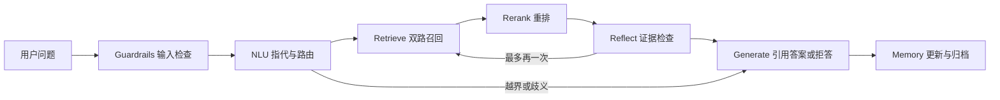

# 架构与七阶段

这是以 learn-claude-code 的 messages/tool loop 和上下文管理思想为基准的领域实现，并非上游已经拥有论文问答。固定上游 SHA 为 `ce8f9f186058939da54c9d6fead78dfb5d0fd6c3`。原始选定文件保存在 [references](../references/learn-claude-code/SNAPSHOT.md)，复用审查见 [基准审查](../LEARN_CLAUDE_CODE_REVIEW.md)。

入口为 [PaperPipeline.run](../src/paper_agent/pipeline.py)。`PaperAgentState` 包含 session_id、messages、turn_count 和 SessionMemory；该类是新增代码，上游 s01/s02 并没有同名状态结构。

七阶段并不等于七次 API 请求。正常回答使用 NLU、Reflect、Generate 三次请求；二次检索增加一次 Reflect。输入校验、检索、重排、存储在本机执行。越界或澄清一般仅需 NLU。最多两轮检索；失败保留 trace 并抛出，不伪造答案。

接口：`retriever.search()` 返回候选和证据；`reasoner.structured(stage, payload)` 返回校验后的 JSON。离线测试用显式 fixture，CLI 的 ask/chat 用兼容 API。独立的通用 tool_loop 保留 s02 的工具调用机制，但七阶段主流程直接调用检索组件，不假装调用了模型原生 tool calling。

Guardrails 当前只处理空问题、长度、控制字符和随后阶段的结构/范围约束，不是完整的提示注入检测或安全分类器。文档与检索证据作为数据传入，系统提示禁止执行其中的命令；该措施不能视为已验证的攻击防御。

范围限定：本地论文库、CLI、检索、引用、会话和评测。没有额外加入 Web UI、知识图谱、联网研究或多 Agent。

## 本轮恢复机制

七阶段不变。NLU 前/后按需读取同 session 归档上下文；Provider 对临时错误有限重试，重排与单路检索按配置降级；Memory 用稳定 turn_id 和单原子 state.json 提交。错误回滚本轮状态，Trace 记录 degraded、commit_status 与所有 API 尝试。归档不是论文证据。见 [记忆](memory.md)、[API](api.md) 和 [评测](evaluation.md)。
