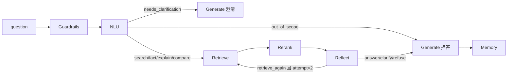

# 实现审计报告（Implementation Audit）

日期：2026-10-22。本报告以实际源码为准，逐项核对七个阶段、状态流、Trace、记忆与评测的实现状态，不根据 README 或设计文档推断“已实现”。所有结论均对应到具体文件、函数与行号。

## 1. 架构与真实执行顺序

七阶段编排入口为 `PaperPipeline.run()`（`src/paper_agent/pipeline.py`）。真实执行顺序如下，与参考截图的阶段名称一致：

关键事实：

- **七阶段 ≠ 七次 LLM 调用**。Retrieve/Rerank 是确定性本地组件（BM25/FAISS/Cross-Encoder），Guardrails/Memory 是本地逻辑。正常回答仅 3 次 LLM 调用（NLU、Reflect、Generate），二次检索再增加 1 次 Reflect，语义压缩再增加 1 次 memory_summary。
- `PaperPipeline.run()` 的 `mode` 参数决定检索链路：`rerank` 模式内部先用 `hybrid` 召回 30 候选，再在 Rerank 阶段做 Cross-Encoder 二次排序；`bm25/dense/hybrid` 模式则直接用该模式召回并在 Rerank 阶段仅截取前 5（无 Cross-Encoder）。
- 通用 `tool_loop()`（`src/paper_agent/runtime.py`）是独立复用的 Harness 基座，**并未被 `PaperPipeline` 调用**。七阶段主流程直接调用 `retriever.search()` 与 `reasoner.structured()`，不通过 Anthropic 原生 tool calling。`tool_loop` 仅在 `tests/test_core.py::test_tool_loop_fills_all_ids_and_errors` 中被验证。

## 2. 核心模块与接口表

| 模块 | 文件 | 关键接口 | 状态 |
|---|---|---|---|
| 状态 | `pipeline.py` | `PaperAgentState`（session_id/messages/turn_count/memory）、`load/save` | 已实现并贯穿全程 |
| Trace | `pipeline.py` | `TurnTrace`、`stage()`、`finish()` | 已实现；记录每阶段 input/output/status/elapsed_ms/error |
| 编排 | `pipeline.py` | `PaperPipeline.run()`、`compact_state()` | 已实现 |
| Provider | `providers.py` | `APIConfig.from_env()`、`CompatibleReasoner.structured()`、4 个 JSON Schema | 已实现 |
| 检索 | `retrieval.py` | `Retriever.search()`、`rrf()`、`BGEEncoder`、`BGEReranker`、`build_index()` | 已实现 |
| 语料 | `corpus.py` | `Chunker.split()`、`ingest_jsonl()`、`pdf_paper()` | 已实现 |
| 记忆 | `memory.py` | `SessionMemory.update/load/save`、`ContextArchive`、`validate_citations()` | 已实现 |
| 压缩 | `compaction.py` | `semantic_compact_state()` | 已实现 |
| 工具循环 | `runtime.py` | `tool_loop()` | 已实现但未接入主流程 |
| 评测指标 | `evaluation.py`、`task_metrics.py` | `retrieval_metrics`、`classification/boundary/pipeline_success/memory_consistency/token_reduction` | 已实现 |
| 存储 | `storage.py` | `digest/read_jsonl/write_json/atomic_text/safe_id` | 已实现 |
| CLI | `cli.py` | `ingest/pdf/index/search/eval/shell/ask/chat` | 已实现 |

## 3. 七阶段实现清单

### Guardrails（pipeline.py:95-98）

| 核对项 | 结果 |
|---|---|
| 空输入 | ✅ 已实现：`not question.strip()` 抛 ValueError |
| 超长输入 | ✅ 已实现：`len(question) > 20000` 抛 ValueError，确定性失败 |
| 非法字符/无效请求 | ⚠️ 部分：无显式非法字符/无效请求检查，交由 NLU 与后续阶段处理（符合“不把普通范围外问题当恶意输入”的原则，但计划 C1 的“非法字符”项未单列） |
| 拦截入 Trace | ✅ 拦截产生的异常会进入 Guardrails stage 的 `status=error` 并写入 trace |

### NLU（pipeline.py:99-113；providers.py:22-27,36-40）

| 核对项 | 结果 |
|---|---|
| 五分类意图 | ✅ search/fact/explain/compare/out_of_scope，schema 枚举校验 + 二次校验 |
| 查询改写 | ✅ `standalone_query` 必填，非空校验 |
| 指代消解/论文范围 | ✅ `resolved_entities`、`paper_ids`；`paper_ids` 强校验必须来自目录，未知 ID 抛错 |
| 低置信度/澄清 | ✅ `needs_clarification` 布尔 → 决策 clarify |
| JSON 解析失败/无效意图 | ✅ jsonschema 校验失败抛错，无效意图抛 ValueError，均入 trace |
| 目录规模 | ✅ 传入全部 `paper_catalog`（当前 100 篇）；大规模需先做目录检索（已记录限制） |

### Retrieve 与 Rerank（pipeline.py:117-137；retrieval.py:123-166）

| 核对项 | 结果 |
|---|---|
| BM25 / Dense / Hybrid / RRF | ✅ `search()` 支持 4 种模式；RRF `k=60`、rank 从 1 起、去重、chunk_id 平局 |
| 候选去重与过滤 | ✅ 先按 `paper_ids` 过滤位置再截取候选；空数组返回空 |
| RRF/Cross-Encoder/过滤 三者区分 | ✅ 代码分离：`rrf()` 融合、`BGEReranker.score()` 二次排序、`allowed` 过滤 |
| 降级与失败 | ✅ 无真实 encoder/index/reranker 时抛错，**不隐式降级**；异常在 `evaluate_retriever` 中记录为该题 error |
| Top-K 口径 | ⚠️ Pipeline 内硬编码 `top_k=30`（检索召回）与 `candidates[:5]`（证据），未走 `configs/` 统一配置；`retriever.search` 默认 `candidate_k=30` |

### Reflect（pipeline.py:138-153）

| 核对项 | 结果 |
|---|---|
| 决策空间 | ✅ answer / retrieve_again / clarify / refuse（计划 C4 的“abstain”用现有枚举“refuse”统一） |
| 二次检索上限 | ✅ `for attempt in (1, 2)`；attempt=2 仍 retrieve_again 时强制 refuse + `retrieval_budget_exhausted` |
| next_query 必填 | ✅ retrieve_again 必须给出非空 next_query，否则抛错 |
| 证据集合入 Trace | ✅ Retrieve/Rerank/Reflect 阶段的 output 记录 candidate_ids / evidence_ids |
| 空证据保护 | ✅ Reflect 选 answer 但证据为空时 Generate 阶段改判 refuse |

### Generate 与引用校验（pipeline.py:154-169；memory.py:87-97）

| 核对项 | 结果 |
|---|---|
| 结构化 claims/citations | ✅ generate schema：每条 claim 有 key/text/citations，1..12 条 |
| 引用 ID 真实存在 | ✅ `validate_citations` 检查 chunk_id 在本次 evidence 中 |
| 引用论文归属 | ✅ 检查 `chunk["paper_id"] == cite["paper_id"]` |
| 不静默修复 | ✅ 校验失败抛 ValueError，不替换成其他引用 |
| 失败后的受控处理 | ⚠️ 部分：引用校验失败会**整轮报错**（trace status=error、run_dialogues 记为 error），未实现计划 C5 要求的“受控重试/修正/拒答” |
| 格式合法率 vs 语义支持率 | ✅ 已明确分离：`validate_citations` 仅结构校验；语义支持需独立 Judge/人工（`summarize_live.py` 中 `citation_ids_valid` 只测结构） |

### Memory（pipeline.py:170-186；memory.py:13-47）

| 核对项 | 结果 |
|---|---|
| 会话隔离 | ✅ SessionMemory 按 session_id 存盘，load 校验 session_id 一致 |
| 写入时机 | ✅ 每轮 Generate 后：answer 写 facts/entities，非 answer 只写 unresolved；消息始终追加 |
| 冲突更新 | ✅ 相同 key 的新事实覆盖旧值并移到最近位置；实体同样覆盖 |
| 证据保留 | ✅ facts 保存 evidence_ids 且必须 ⊆ 本轮 valid_evidence |
| 近期消息/历史摘要预算 | ✅ `compact_state` 保留最近 8 消息、40 事实、20 实体；语义压缩额外产生 summary.overview |
| 压缩失败回退 | ⚠️ 部分：语义压缩失败会抛错并整轮失败；确定性裁剪本身不失败，但**没有“语义压缩失败自动回退到确定性裁剪”**的路径 |
| 归档可检索/恢复 | ✅ `ContextArchive.read()` 按内容哈希回读并校验哈希；但**归档回读目前是 Python 接口，未暴露为问答模型可用的工具**（已记录限制） |
| 两种压缩区分 | ✅ 配置 `memory_strategy`（bounded/semantic）、Trace `compaction.method`、`--memory-strategy` CLI 参数均明确区分 |

## 4. 状态流与 Trace 核对

- `PaperAgentState` 的字段（session_id/messages/turn_count/memory）确实贯穿 `run()` 全程，并在 `state.save()` 后落盘。
- `TurnTrace` 完整记录每个阶段的 input/output/attempt/status/elapsed_ms/error；异常经 `finally` 保证 `trace.finish()` 写入；未执行阶段标记 `skipped` 并附带本轮 status 作为 reason。
- 每个阶段内额外 `api_calls` 切片（`reasoner.calls[call_start:]`）写入 trace，用于把本轮 LLM 调用与 trace 关联。

发现的问题（详见第 6 节）：`state.save()` 与 `SessionMemory.save()` 的文件名处理不一致（一个用 `self.session_id`，一个用 `safe_id(...)`），但二者均已在构造时校验，功能等价，非缺陷。

## 5. 与参考截图的逐项对应

| 截图/计划项 | 本项目对应 | 状态 |
|---|---|---|
| 七阶段 Pipeline | `PaperPipeline` + `STAGES` 元组 | ✅ |
| 意图五分类 | NLU schema enum | ✅ |
| Query 改写 | NLU `standalone_query` + `--no-rewrite` 消融 | ✅（准确率未测） |
| BM25/Dense/Hybrid/Rerank | `Retriever.search` 四模式 + GPU 实测 | ✅（真实召回结果已产出） |
| Reflect 四决策 + 二次检索上限 | `for attempt in (1,2)` + 强制 refuse | ✅ |
| 引用校验 | `validate_citations`（结构） | ✅（语义未测） |
| 会话记忆/压缩/归档 | `SessionMemory` + `compact_state`/`semantic_compact_state` + `ContextArchive` | ✅（质量未测） |
| 可观测性/Trace | `TurnTrace` + `api_calls` + `usage` | ✅ |
| LLM-as-Judge | `judge_live.py`（探索性，维度不全） | ⚠️ 部分 |
| 统一 eval 子命令 | 无（仅有检索 `eval`） | ❌ 未实现 |

## 6. 缺陷与建议修改

### D1. 引用校验失败整轮报错，而非受控拒答/修正（计划 C5）

- **位置**：`pipeline.py:164`（`validate_citations(...)` 抛 ValueError 后传播至外层 except → trace status=error）。
- **复现**：让 generate 返回 `citations` 含不存在的 chunk_id，运行 `ask` 或 `run_dialogues`。
- **影响**：合法“拒答/修正”业务结果被记为技术错误，污染 Pipeline Success Rate 与拒答口径。
- **建议**：在 Generate 阶段捕获 `validate_citations` 失败，改为受控 `refuse`（或有限次数的模型修正重试），并记录 `reason_code=citation_validation_failed`。

### D2. Guardrails 缺少“非法字符/无效请求”检查（计划 C1）

- **位置**：`pipeline.py:95-98`。
- **建议**：可按需增加控制字符/不可解码输入检查，但保持“范围外问题不当作恶意输入”的原则；拦截结果入 trace。

### D3. 无统一 `eval` 子命令族（计划 E）

- **位置**：`cli.py` 仅 `eval`（检索）。
- **建议**：新增 `eval smoke/intent/rewrite/retrieval/boundary/memory/e2e/all/compare/ablation`，复用 `evaluation.py`/`task_metrics.py` 与脚本。

### D4. LLM-as-Judge 维度不完整（计划 E1）

- **位置**：`scripts/judge_live.py` 只评 answer_correct/rewrite/claim support，缺 Relevance/Completeness/Appropriate abstention 等 6 维。
- **建议**：扩展 judge schema 与提示词，并保存维度分数、理由、模型标识与调用记录。

### D5. 语义压缩失败无回退路径（计划 C6）

- **位置**：`pipeline.py:181-182`（`semantic_compact_state` 抛错即整轮失败）。
- **建议**：捕获语义压缩异常，回退到 `compact_state` 并在 Trace 记录 `compaction_fallback=deterministic`。

### D6. 数据集未按计划路径/审核状态落地（计划 D）

- **位置**：数据集在 `data/dialogues-draft/`（`draft_unreviewed`）与 `data/qasper/`，计划建议 `data/eval/*.jsonl` 且需人工审核参考标签。
- **影响**：`score_dialogues.py` 拒绝草稿标签，正式效果评分无法运行。
- **建议**：建立 `data/eval/`，冻结协议，产出经审核的 reference 标签（LLM 起草标签必须人工复核后使用）。

### D7. 无 git 仓库与 `configs/evaluation.json`

- **位置**：仓库根目录无 `.git`（`git rev-parse` 失败）；`configs/` 仅 `offline.json`。
- **影响**：计划 F 要求记录 Git commit 无法实现；评测配置未统一落地。
- **建议**：初始化 git（如需）并新增 `configs/evaluation.json` 记录数据集路径、模型、Top-K、重排、Reflect 开关、记忆策略、预算、seed、Judge 配置。

## 7. 已实现 / 部分实现 / 未实现汇总

**已实现（有测试或真实结果支撑）**：语料分块与溯源、BM25/FAISS/RRF/Cross-Encoder 检索四组基线、七阶段编排、二次检索上限、引用结构校验、会话记忆与归档、确定性/语义两种压缩、TurnTrace、真实 GPU 检索评测与配对 bootstrap。

**部分实现（逻辑存在但缺计划要求的完整行为）**：引用失败受控处理（D1）、Guardrails 非法输入（D2）、语义压缩回退（D5）、LLM-as-Judge（D4）、多轮数据（D6，草稿未审核）。

**未实现**：统一 eval 子命令族（D3）、`configs/evaluation.json`、真实 API smoke 记录（待阶段 B 补齐）、`data/eval/` 正式集、git commit 记录。

## 8. 边界与已知限制

- `tool_loop()` 未接入主流程，属独立 Harness 能力；不能据此声称“调用模型原生 tool calling”。
- 引用结构校验 ≠ 语义支持；二者在报告与文档中已分离。
- 检索召回指标是段落覆盖代理，非答案正确率；四组 bootstrap 区间跨零。
- `.env` 当前配置 OpenCode `zen/go/v1` 路径，需在阶段 B 实测确认联通性（文档已提示旧路径与新版 `/inference/go/openai/v1` 不同）。
